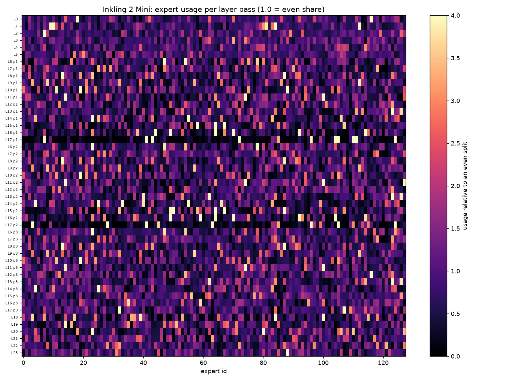
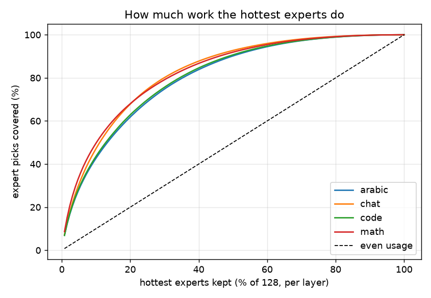
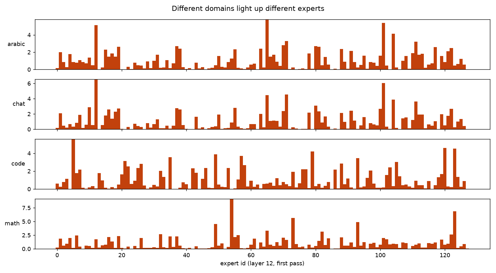
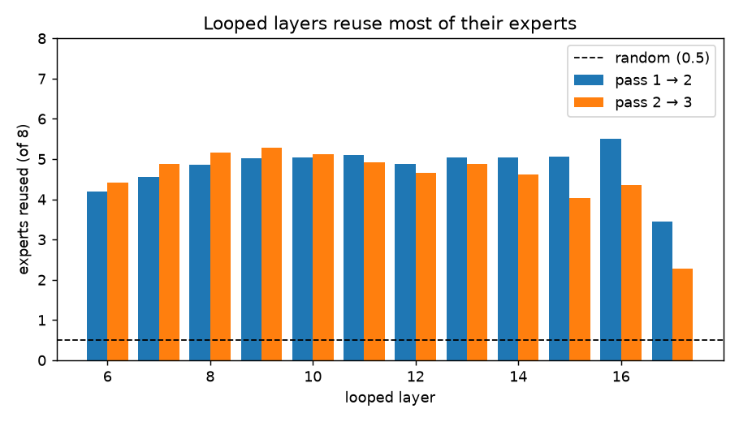

# moe-expert-map

**Can a smarter placement of Mixture-of-Experts weights make big models run faster on ordinary PCs?**

Modern open models like Inkling 2 Mini (26.4B parameters, 3.4B active) are *Mixture-of-Experts*:
each token only uses 8 of 128 experts per layer. On a consumer PC the model does not fit in GPU
memory, so tools like llama.cpp keep the shared layers on the GPU and all experts in system RAM.

## Headline

On a 6 GB RTX 2060 + Ryzen 5 5600X, Inkling 2 Mini goes from **2.4 tokens/s (CPU only)** to **17–19 tokens/s**
with up to **64K context**. The key trick is putting the experts of the layers that run three times per token on the
GPU (loop-aware placement), which is **1.5× faster than llama.cpp's default offload** for the same VRAM.

| What | Where |
|---|---|
| Expert-usage logger for llama.cpp | `tools/moe-trace` |
| Loop-aware placement benchmark | Result 1, `scripts/bench.ps1` |
| VRAM tuning for speed and 64K context | Result 2, `scripts/gen_speed.ps1` |
| Why speculative decoding hurts MoE offload | Result 2 |
| Chat template fix and a llama.cpp tool-call bug | "Chat with it" |

## Quick start (Windows)

1. Download the official llama.cpp CUDA build (b12622 or later) and unzip it to `toolchain/llama-cuda`.
2. Download `Mainline_Support/Inkling-2-Mini-UD-Q2_K_XL.gguf_file` from
   [unsloth/Inkling-2-Mini-GGUF](https://huggingface.co/unsloth/Inkling-2-Mini-GGUF) and save it as
   `models/Inkling-2-Mini-UD-Q2_K_XL-mainline.gguf`.
3. In Git Bash run `./chat.sh` (or `./chat.sh long` for 64K context) and open http://localhost:8080.

## The idea

This project asks whether we can do better by treating the PC as a memory hierarchy:

| Tier | Example (author's PC) | Bandwidth | Size |
|---|---|---|---|
| GPU VRAM | RTX 2060 | ~336 GB/s | 6 GB |
| System RAM | DDR4 | ~45 GB/s | 16 GB |
| NVMe SSD | Crucial P3 | ~3.5 GB/s | 1 TB |

## Plan

1. **Measure** which experts each token uses, per layer, across different kinds of text
   (code, chat, math, other languages). Are some experts "hot" and others almost never used?
2. **Place** hot experts on the GPU, warm ones in RAM, cold ones on the SSD.
3. **Predict** which experts the next layer will need and load them ahead of time.
4. **Benchmark** tokens/second against llama.cpp's default `--n-cpu-moe` split.

## The expert map (56,760 tokens, 4 domains)

Inkling-2-Mini UD-Q2_K_XL has 24 physical layers; layers 6–17 run 3 times, so each token makes 48 layer passes,
each picking 8 of 128 experts. `tools/moe-trace` recorded every pick for about 12–19K tokens per domain:

- **chat, math, Arabic:** written by Inkling itself from 16 varied prompts each (`scripts/gen_corpus.py`); the model
  thinks in English before answering, so the Arabic set is English reasoning plus Arabic answers
- **code:** Python from llama.cpp's `gguf-py` (MIT licensed, `data/corpus/code.LICENSE.txt`)

| Question | Pilot (~1,000 tokens) | **Full dataset (56,760 tokens)** |
|---|---|---|
| Skew: picks handled by the hottest 10% / 25% of experts per layer (even would be 10% / 25%) | 36% / 60% | **32% / 54%** |
| Domains: shared favourite experts (top 32 per layer), code vs chat | 9% | **5%** |
| Domains: chat vs Arabic chat | 44% | **58%** |
| Prediction: next layer's experts guessed by a co-occurrence table (random 6%) | 48% | **44%** |
| Loop reuse: experts repeated by the same token, pass 1→2 / 2→3 (random 0.5 of 8) | 4.8 / – | **4.8 / 4.6** of 8 |



**Within one domain** the hottest 20% of experts handle about 65–70% of the work, so a placement that adapts to the
task can keep far more of the work on the GPU than a fixed one:



Code and math light up very different experts from chat and Arabic chat (layer 12, first pass shown):



Every looped layer reuses most of its experts from one pass to the next, which is what makes loop-aware placement work:



Caveats: measured on a 2-bit model; the next-layer predictor is trained and tested on alternating positions of the same
texts, so 44% is an upper estimate for unseen text.

### Lesson learned: verify the tracer

A faster tracer built on the official prebuilt CUDA DLLs (`tools/moe-trace/moe-trace-gpu.cpp`, C API only) recorded
experts `0–7` with `NaN` weights for layer passes 18 and later, for every token. Its CPU and GPU runs agreed 100%,
but only because both were broken; the source-built tracer (`moe-trace`) records valid routing and matches it 99% on
layers 0–17. Normal inference is not affected (19/20 on a fact check, `scripts/fact_check.ps1`). All results here use
`moe-trace`, and `scripts/analyze.py` and `scripts/plot.py` now drop and report any row with NaN weights.

## Result 1: loop-aware expert placement (+52% over llama.cpp's default)

Layers 6–17 of Inkling 2 Mini run three times per token, so their experts are read three times as often.
llama.cpp's `--n-cpu-moe` always moves the *last* layers' experts to the GPU. Moving the *looped* layers' experts
instead gives a big speedup for the same amount of VRAM.

Generation speed (tokens/s, 64 tokens, mean of 3 runs), RTX 2060 6 GB + Ryzen 5 5600X, llama.cpp b12622:

| Setup | Expert layers on GPU | tokens/s |
|---|---|---|
| CPU only | none | 2.4 |
| GPU, all experts in RAM (`-ngl 99 --n-cpu-moe 99`) | none | 9.4 |
| GPU, llama.cpp default (`--n-cpu-moe 14`) | 14–23 (10 layers) | 11.5 ± 2.7 |
| **GPU, loop-aware** (`-ot "blk\.([8-9]\|1[0-7])\.ffn_.*_exps=CUDA0;exps=CPU"`) | **8–17 (10 looped layers)** | **17.5 ± 0.9** |

That is **7.2× faster than CPU only** and **1.5× faster than the default offload**, with no change to the model or its output.
With 12 expert layers on the GPU both setups slow down (6 GB VRAM is over-full), so 10 layers is the sweet spot on this card.
Reproduce with `scripts\bench.ps1`.

## Result 2: freeing VRAM for more experts and longer context

Where the 6 GB went at 8K context (default settings): weights 4.0 GB, **compute buffer 1.95 GB**, context memory 0.5 GB.
Inkling 2 Mini uses sliding-window attention (1,024 tokens) in 40 of its 48 layer passes, so only 8 passes keep
memory that grows with context: about 32 KB per token at 16-bit, 16 KB at 8-bit, 9 KB at 4-bit.

- Smaller processing chunks (`-ub 128 -b 128`) shrink the compute buffer from 1.95 GB to 1.23 GB.
- 8-bit or 4-bit context memory (`-fa on -ctk q8_0 -ctv q8_0`, or `q4_0`) halves or quarters the growing part.
- The freed VRAM holds more looped expert layers.

Generation speed, 128 tokens, short prompt (`scripts\gen_speed.ps1`):

| Context | Setup | tokens/s |
|---|---|---|
| 8K | 9 looped layers, default chunks (previous) | 18.0 |
| 8K | **12 looped layers, chunks 128, 8-bit context** | **20.6** |
| 32K | 11 looped layers, chunks 128, 4-bit context | 18.9 |
| 64K | **10 looped layers, chunks 128, 4-bit context** | **18.8** |

When VRAM overflows (for example 12 layers with 16-bit context memory) speed falls to ~12 tokens/s, so each setting is
right at the edge of 6 GB. These speeds are measured with an almost empty context; they drop as a long conversation fills it.

Inside `llama-server` a little more VRAM is used, so 10 looped layers is the stable maximum there (measured over real
chat requests with `scripts\server_test.ps1`):

| Server mode | Context | Context memory | tokens/s |
|---|---|---|---|
| `./chat.sh` | 8K | 8-bit | 16.8–18.7 |
| `./chat.sh long` | 64K | 4-bit | 17.0–19.0 |

**Speculative decoding:** the official DSpark drafter (`dspark-Inkling-2-Mini-Q8_0.gguf`) does not load in mainline
llama.cpp b12622: its `markov_w1` uses the padded vocabulary (201,024) while mainline expects 200,058.
Its model card points to the Unsloth llama.cpp fork for now.

Tested with the Unsloth fork (b12588-mix-c0c3de8) and the Unsloth-format UD-Q2_K_XL file, 8 looped expert layers on GPU,
8K context, 8-bit context memory, same three prompts:

| Setup | tokens/s | Draft acceptance |
|---|---|---|
| Unsloth fork, no draft | 11.7–13.5 | – |
| Unsloth fork + DSpark draft (`--spec-draft-n-max 3`) | **6.4–7.2** | 43–64% (2.3–2.9 tokens per step) |
| Mainline b12622, no draft, 10 looped layers (for comparison) | 16.8–18.7 | – |

**Speculative decoding makes this setup ~2× slower even though half the guesses are accepted.** On a dense model, checking
four guessed tokens reads the weights once, so it is almost free. In a Mixture-of-Experts model each guessed token picks its
own 8 experts, so checking 4 tokens can mean reading up to 4× as many experts from RAM, and RAM bandwidth is exactly the
bottleneck when experts live in system memory. The drafter also takes VRAM that would otherwise hold expert layers.
Speculative decoding only pays off for MoE models when the experts being verified are already in fast memory.

## Result 3: letting cold experts sleep for good (usage-aware expert pruning)

Without changing llama.cpp, the only way to give each layer's *hot* experts more GPU room is to remove its cold ones.
`scripts/prune_experts.py` ranks every layer's experts by the total routing weight they received across all loop
passes in the 56,760-token traces, keeps the top K, and slices all per-expert tensors (`ffn_gate_up_exps`,
`ffn_down_exps`, their scales, the router `ffn_gate_inp` and its bias `exp_probs_b`) to match. Tokens that would have
picked a removed expert simply get the next best one. Smaller expert tensors let more looped layers sit on the GPU.

Quality is measured on 40 prompts **not used for pruning** (`scripts/quality_eval.py`): greedy 64-token continuations
compared token by token with the full model. A harmless change (8-bit context memory) is shown as the noise baseline.

| Model | File size | Routing weight kept | Tokens identical to the full model (mean of 64) | Chat speed (8K, server) |
|---|---|---|---|---|
| Full, 128 experts | 8.5 GB | 100% | 64 (reference) | 17–19 tokens/s |
| Full, 8-bit context memory (noise baseline) | 8.5 GB | 100% | 41.9 | 17–19 tokens/s |
| **Pruned to 112 experts** | 7.6 GB | 96–99.6% per layer | 14.3 | **21–23 tokens/s** (13 GPU layers) |
| Pruned to 96 experts | 6.7 GB | 89–98% per layer | 8.3 | 23–24 tokens/s (16 GPU layers) |

**Verdict:** pruning buys **+20–30% speed but clearly changes the model**. Even the gentle 112-expert cut drifts from the
original much sooner than the noise baseline. At 96 experts the model starts contradicting itself
(*"1789. False, 1789 is the wrong year…"*). On the 20-question fact check both pruned models still score 19/20.
The 1–4% of routing weight that cold experts carry matters more than the numbers suggest, so the lossless route
(per-expert placement inside llama.cpp, keeping every expert) is the right next step. `./chat.sh lite` runs the
112-expert model for anyone who prefers speed.

## Result 4: what limits speed now

- **More CPU threads help:** 6 → 18.5, 8 → 20.3, 12 → 21.0 tokens/s (`chat.sh` now uses 12). If RAM speed were the
  limit, extra threads would not help.
- **RAM is mostly idle:** at ~19 tokens/s the CPU-side experts need only ~4 GB/s of the ~45 GB/s available.
- **Cost per CPU expert pass:** all experts on CPU (48 passes) takes 106 ms per token, loop-aware placement
  (18 passes) 54 ms, so each CPU pass costs about **1.7 ms**, of which reading its 8 experts from RAM is only ~0.4 ms.
  The rest is the CPU decoding the very small formats this file uses (IQ1_S at 1.6 bits for layers 0–4 and 6,
  IQ2_* for the others, Q2_0 / NVFP4 / MXFP4 for the down projections).
- **Repacking CPU experts to a simpler format does not help yet:** Q8_0 keeps them almost exact (0.2–0.5% error) but is
  5× more data and made generation slower (16.4 vs 20.7 tokens/s for layers 0–4). Q4_0/Q5_0 written by gguf-py's
  simple quantizer add 3–11% error. A proper requantization would need the original 16-bit weights and llama.cpp's
  own quantizer (`scripts/repack_cpu_experts.py` is kept for experiments).

## Chat with it

`./chat.sh` (Git Bash) starts `llama-server` with loop-aware placement and opens a chat page at http://localhost:8080.
With an 8,192-token context, 9 looped expert layers on the GPU is the sweet spot on 6 GB: **~16–18 tokens/s** in real chats.

**Template fix:** the chat template inside the GGUF never opens the model's turn (`add_generation_prompt` is ignored),
so the model only produces an empty reply that repeats `<|content_invoke_tool_text|>`. `templates/inkling2-chat-fixed.jinja`
adds the missing `<|message_model|>` and is passed with `--chat-template-file`.

**Tool bug (llama.cpp b12622):** any chat request that includes tool definitions makes the model repeat
`<|content_invoke_tool_text|>`, and **every later request on that server is broken too** until it restarts.
It happens with the default placement as well, so it is not caused by loop-aware placement. The llama-server web page
sends its built-in browser tools with every message, so turn them off once in the page (they are saved per browser):
open http://localhost:8080, press F12, and run this in the Console, then reload:

```js
localStorage.setItem('LlamaUi.disabledToolCategories', JSON.stringify(['browser','custom','mcp','server']))
```

Reproduce: `powershell -File scripts\server_test.ps1 -Label test -Sequence "plain,tools,plain" -Extra "-ncmoe","99"`
(plain requests work; the tools request and everything after it come back empty).

## Progress and goals

**Goal:** make large Mixture-of-Experts models genuinely usable on an ordinary gaming PC by treating
GPU memory, system RAM and SSD as one memory hierarchy, and placing each part of the model where it is
used most. Target on this PC: **25–40 tokens/s** for Inkling 2 Mini with long context, without changing the model.

### Done

| Milestone | Outcome |
|---|---|
| Portable build setup on Windows (no installs on C:) | `scripts/build.ps1`, w64devkit + CMake |
| Expert-usage logger for llama.cpp | `tools/moe-trace` records experts and weights per token and layer |
| Pilot expert map (~1,000 tokens, 4 domains) | Experts are skewed; code and chat use different experts; next-layer choices are predictable (48% vs 6% random) |
| Discovery: looped layers reuse experts | 4.8 of 8 experts repeat between loop passes |
| GPU offload | 2.4 → 9.4 tokens/s |
| **Loop-aware placement** | **17.5 tokens/s vs 11.5** for llama.cpp's default with the same VRAM |
| VRAM tuning (compute buffer, 8/4-bit context memory) | 64K context at the same speed (17–19 tokens/s in chat) |
| Speculative decoding test (DSpark drafter) | 2× slower on MoE with experts in RAM; reason explained |
| Chat setup | Fixed chat template; found and worked around a llama.cpp tool-call bug |

### Next

- [x] Larger dataset (56,760 tokens) confirms the pilot numbers; heatmaps in `docs/`
- [ ] Placement simulator: predict tokens/s for any placement from traces and hardware bandwidths
- [x] Usage-aware expert pruning: +20–30% speed, but measurable quality drift (Result 3)
- [ ] Per-expert hot/cold placement inside llama.cpp (hot experts of every layer on GPU, cold ones in RAM); estimated 1.4–1.6×
- [ ] Loop expert cache: keep experts used in pass 1 ready for passes 2 and 3
- [ ] Usage-aware precision: cold experts at very low bit-width (e.g. NanoQuant-style), hot ones at higher quality
- [ ] Report the tool-call bug and the eval-callback NaN routing to llama.cpp with reproduction scripts

## Hardware used

AMD Ryzen 5 5600X · 16 GB DDR4 · NVIDIA RTX 2060 6 GB · NVMe SSD · Windows 10

## Related work

- PowerInfer (Song et al., 2023): hot/cold neuron split between GPU and CPU
- LLM in a Flash (Alizadeh et al., Apple, 2023): running models from flash storage
- KTransformers: MoE experts on CPU, attention on GPU
- SmallThinker (2025): a model designed for local hardware with expert prefetching

## License

MIT
